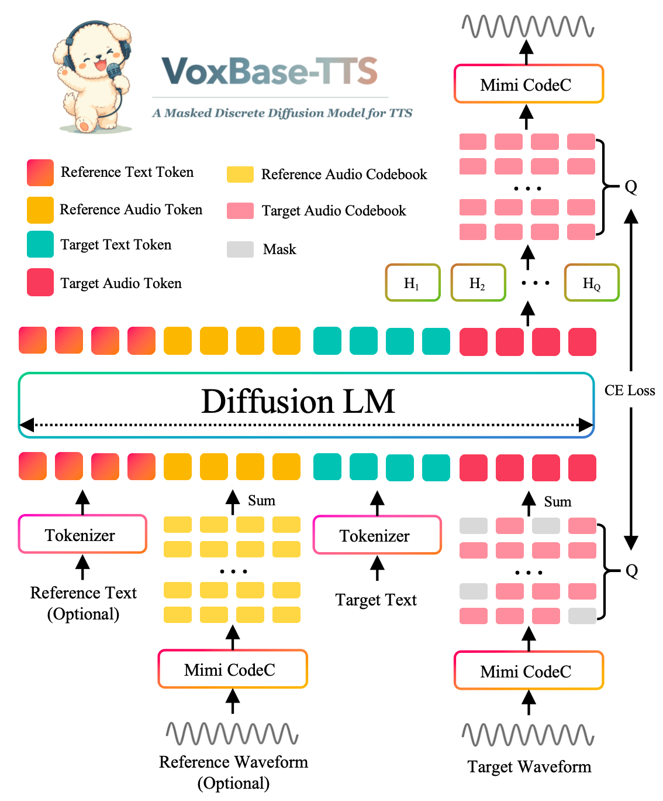

<p align="center">
  
</p>

## 项目定位

---

> 在 [VoxBase-s2s](https://github.com/GHJ20001017/VoxBase-s2s) 中，我们曾围绕 LLM 探索 Speech-to-Speech 模型的训练与实现。沿着这条路线继续前行，我们希望将注意力延伸到基于离散 Codec Token 的 Masked TTS，尝试以更清晰、更直接的建模路径，逐步构建一个易于理解、训练与复现的 TTS 模型。

## 项目介绍

VoxBase-TTS 是一个面向学习、研究和工程验证的文本到语音实验项目。项目以 **Qwen3-0.6B** 为语言建模主干，将文本、可选的参考文本与参考语音 codec tokens 组织为统一序列，并通过 Masked Codec Token 预测学习目标语音的离散表示。

项目当前聚焦于 **codec token 建模与可复现训练流程**，而不是完整的端到端音频产品。仓库提供数据读取、模型训练、断点恢复、TensorBoard、离线 token 推理和测试代码，方便逐步理解从文本条件到离散语音表示生成的完整过程。

传统 TTS 通常在文本、声学特征和波形之间采用多阶段流水线；VoxBase-TTS 选择先建模离散音频 token，将每一帧的多个 codebook token 聚合到同一个 Transformer 位置，再由独立预测头恢复各 codebook 的类别。

这种设计的目标是：

- 复用 Qwen3 的文本表示和上下文建模能力；
- 使用 Masked Token Learning 训练离散语音表示，而不是逐 token 自回归生成；
- 通过可选的参考文本和参考 codec tokens 支持说话人或表达条件的实验；

## 模型结构

<p align="center">
  
</p>

- **文本输入**：目标文本经过 Qwen tokenizer 和文本 embedding，不做 G2P 预处理。
- **参考条件**：可选的参考文本和对齐 codec tokens 会放在目标条件之前；参考部分不参与目标音频的 MASK 损失。
- **音频表示**：每个 codebook 使用独立的可训练 embedding 和分类头。设码本数量为 `Q`、类别数为 `K`，每张 embedding 表包含 `K + 1` 行，额外一行用于音频 MASK。
- **帧内聚合**：同一帧的 `Q` 个音频 embedding 求和并除以 `sqrt(Q)`，每帧的多个 codebook token 聚合为一个 Transformer 序列位置。
- **双向主干**：Qwen3 主干使用双向注意力，支持 `sdpa` 和 `eager` 两种 attention backend；不依赖 Flash Attention 2。
- **Masked 预测**：训练时只在真实目标 `Q × T` 位置中采样 MASK，不 MASK padding，也不要求整帧一起 MASK。MASK 比例会作为时间条件加入目标音频 embedding。
- **多码本输出**：共享主干特征经过 `RMSNorm → Linear → SiLU` 后，由每个 codebook 的独立分类头预测 `K` 个类别；各分类头共享特征，但不共享 logits，也不按 codebook 自回归。

## 环境安装

请先安装与本机 GPU 驱动匹配的 CUDA 版 PyTorch，再安装项目依赖：

```bash
python -m pip install -r requirements.txt
python -m pip check
```

启动训练：

```bash
bash scripts/train.sh configs/train.yaml
```

也可以直接运行并覆盖 epoch 数：

```bash
python train.py --config configs/train.yaml
bash scripts/train.sh configs/train.yaml --epochs 2
```

程序只支持单进程、单 GPU，不支持 DDP；不要使用 `torchrun` 启动。

## 推理：cosine 解码

### 生成 cosine codec tokens

推理需要训练输出目录中的 checkpoint、`backbone_config.json` 和 `tokenizer/`。cosine 解码从全 MASK 的 `[8, T]` codec 网格开始，每一轮按照每个码本内部的置信度排序并填充对应 quota；已接受的 token 不会在后续轮次被覆盖。

```bash
bash scripts/infer.sh \
  --checkpoint outputs/tts/best.pt \
  --text '你好，欢迎使用 VoxBase-TTS。' \
  --num-frames 100 \
  --decoding-schedule cosine \
  --max-inference-steps 16 \
  --output generated_codes_cosine.pt
```

也可以加入参考文本和参考 codec tokens：

```bash
CUDA_VISIBLE_DEVICES=2 bash scripts/infer.sh \
  --checkpoint outputs/tts/best.pt \
  --text '这是要生成的目标文本。' \
  --num-frames 100 \
  --reference-codes reference_codes.pt \
  --reference-text '这是参考音频对应的文本。' \
  --decoding-schedule cosine \
  --max-inference-steps 16 \
  --device cuda --precision fp16 \
  --output generated_with_reference_cosine.pt
```

输出 `.pt` 中包含 `codes`、`confidence`、MASK 剩余历史、每码本剩余历史、实际 schedule steps 和解码方式等诊断字段。生成的 `codes` 是形状 `[8, T]` 的整数 codec tokens，不是 WAV。

### cosine codec tokens 重建 WAV

需要本地的 Mimi codec 解码器目录和 `soundfile`。将包含 `generated_cosine_*` 码本的 NPZ 文件放入同一目录后运行：

```bash
python scripts/decode_codes.py \
  --codes-dir /path/to/cosine-codes \
  --output-dir outputs/cosine_audio \
  --mimi-model /path/to/mimi-diagnostics \
  --sample-rate 24000
```

脚本会使用 `MimiModel` 将 cosine codec tokens 重建为 PCM-16 WAV，并生成包含时长、RMS、峰值和 SHA-256 的 `manifest.json`。生成的 WAV 和诊断输出属于本地实验产物，不应提交到仓库。
